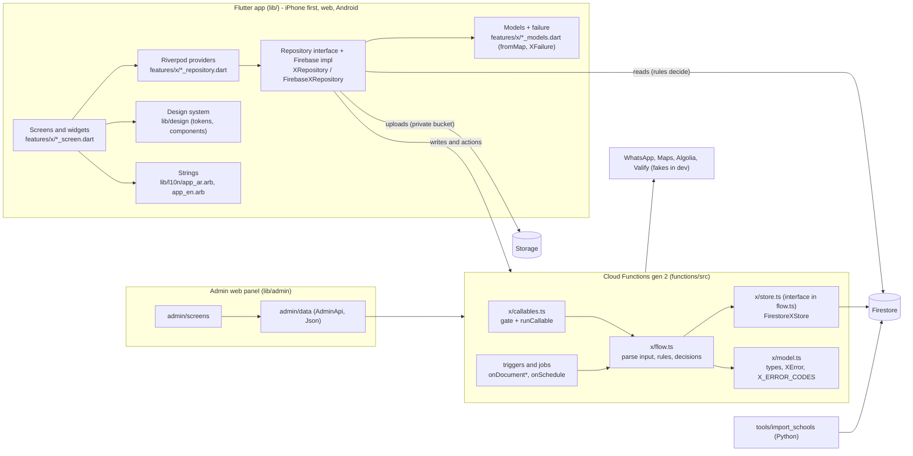

# Architecture overview

How the code is organised today, the conventions every change follows, and
checklists for adding a feature, a collection, a callable or a screen.
Decisions behind it: [decisions.md](decisions.md). Product rules:
`docs/spec.md`, `CLAUDE.md`, `docs/DESIGN.md`.

Measured on 16 Nov 2026 (branch `architecture`): 24 parent-app feature folders
(about 36 000 lines of Dart in `lib/features`), an admin web panel in
`lib/admin` (about 9 000 lines), 18 Cloud Functions domain folders (187 exports:
callables, triggers and scheduled jobs in `functions/src/index.ts`),
Python import tools in `tools/import_schools` and `tool/`, rules tests in
`tests/rules`.

## 1. The picture



- The app **reads** Firestore directly; `firestore.rules` decides what each
  parent may see. Every **write** that matters (status, role, verification,
  membership, schedule ownership, money) goes through a callable
  (`CLAUDE.md`, SECURITY).
- Firestore and Storage rules deny by default; `tests/rules` has a test file
  per area.

## 2. Folder layout

### App (`lib/`)

| Folder | What lives there |
| --- | --- |
| `features/<name>/` | One folder per feature, flat (no sub-folders). See the file roles below. |
| `admin/` | The admin web panel: `data/` (API clients, `Json` reader, models, `AdminFailure`), `screens/`, `widgets/`, `router/`, `auth/`, `shell/`. |
| `design/` | Design system: `tokens/`, `theme/`, `components/` (shared widgets, all in the gallery). Must not import features, admin or the router. |
| `core/` | Small cross-feature types with no Firebase: `app_failure.dart`. |
| `firebase/` | Firebase setup (`firebase_setup.dart`, options per flavor), `collections.dart` (collection names), `callable_error.dart` (reading `details.reason`). |
| `router/` | `app_router.dart` (go_router), `session_redirect.dart`. |
| `config/`, `settings/`, `observability/`, `l10n/` | Flavor, local settings, Sentry with the PII scrubber, ARB files (`gen/` is generated, not committed). |

File roles inside `features/<name>/`:

| File | Role | May import Firebase |
| --- | --- | --- |
| `<name>_models.dart` | Immutable models with `fromMap`/`toPayload`, the `XFailureKind` enum and `XFailure implements AppFailure` | yes (Timestamp, FirebaseFunctionsException) |
| `<name>_repository.dart` | `abstract interface class XRepository`, `class FirebaseXRepository implements XRepository`, and the Riverpod providers (`xRepositoryProvider`, stream providers) | yes |
| `<name>_logic.dart` | Pure logic (no Flutter widgets, no Firebase), unit tested | no |
| `<name>_labels.dart` | Mapping enums to ARB strings | no |
| `*_screen.dart`, `*_widgets.dart`, `*_sheet(s).dart` | UI. Read data only through providers | **no** |

`test/architecture/layering_test.dart` enforces the last column (with a short,
commented list of known exceptions).

### Cloud Functions (`functions/src/`)

One folder per domain (`auth`, `verification`, `carpools`, `schedule`, `trips`,
`chat`, `notifications`, `maps`, `places`, `schools`, `trust`, `privacy`,
`wallet`, `settle_up`, `features`, `admin_panel`, `whatsapp`, `text`) plus
`common/` (shared handler pieces), `config.ts` (params and secrets),
`admin.ts` (Admin SDK singletons), `sentry.ts`/`scrub.ts`, and `index.ts`
(the only list of deployed functions).

| File | Role | Firebase allowed |
| --- | --- | --- |
| `model.ts` | Types, constants, `XError` (`reason`, optional `retryAfterMs`/`details`), `X_ERROR_CODES` (reason -> HttpsError code), pure helpers | **no** |
| `flow.ts` | The business logic: `XDeps` (store, clock, limits, providers), input parsing from `unknown`, every decision; throws `XError` | **no** |
| `store.ts` / `firestore_store.ts` | `FirestoreXStore implements XStore` (the interface is declared in `flow.ts`); the only place that touches Firestore for the domain; owns its collection-name constants | yes |
| `callables.ts` | Wires params into `deps()`, exports the callables, triggers and jobs | yes |
| `admin.ts` (in a domain) | Admin-panel flows of that domain | no |

`functions/test/*.test.ts` test the flows with in-memory stores
(`functions/test/helpers/memory_*.ts`); `functions/test/architecture.test.ts`
enforces the rules marked below.

### Tools

- `tools/import_schools/`: Python import of schools and places (OSM, Overture,
  Wikidata, AI review). Unit tests `test_*.py` (`python3 -m unittest discover -s tools/import_schools`).
- `tool/`: build and setup scripts (`bootstrap.sh`, `patch_native.py`, Cloud
  Shell setup) with their own `test_*.py`.
- `functions/scripts/`: one-off admin scripts (seed, review access, backfills), run through `npm run <name>`.

## 3. Conventions

### Callable handler pattern (functions)

```
export const doThing = gatedCall(opts, (r) => run("doThing", () => doThingFlow(deps(), caller(r), r.data)));
```

1. **Gate** (`privacy/device_gate.ts`, `features/gate.ts`): the factory decides
   who may call. `gatedCall` (valid session, no open new-phone check),
   `sessionCall` (session only), `realParentCall` / `realParentSessionCall`
   (also refuses App Review demo parents), `featureGatedCall` /
   `featureSessionCall` (behind a pilot feature switch), plain `onCall` only
   for sign-in and admin callables (those check the admin claim themselves).
   The options always carry `enforceAppCheck: ENFORCE_APP_CHECK` (tested).
2. **Auth**: `caller(r)` / `requireUid(r)` from `common/callable.ts`
   (`callerOf` adds the `verified` claim). Admin callables use
   `requireAdminCaller` (`admin_panel/guard.ts`).
3. **Input**: the flow receives `r.data` as `unknown` and parses it into a typed
   input (`parseX(data): XInput`), throwing `XError("invalid-request")`.
   Never trust or log the raw data.
4. **Service**: the flow decides, using `deps.store` and `deps.now()`.
5. **Store**: the only Firestore code; transactions for anything that must
   be atomic.
6. **Errors**: `run(name, body)` is a one-line call to
   `runCallable(name, body, { map: [...], fallback })` (tested: no module
   writes its own try/catch). Known `XError`s become
   `HttpsError(X_ERROR_CODES[reason], reason, { reason, ...extras })` without
   logging; anything else is logged by name and message only, reported to
   Sentry (scrubbed) and answered with `internal` (or the module's
   `unavailable` reason).

### Errors across the wire

| Server | Wire | App |
| --- | --- | --- |
| `throw new CarpoolError("no-seats")` | `HttpsError("failed-precondition", "no-seats", { reason: "no-seats" })` | `CarpoolFailure.from(e)` -> `callableReason(e)` = `"no-seats"` -> `CarpoolFailureKind.noSeats` -> `failure.message(l10n)` |
| rate limit | `{ reason: "rate-limited", retryAfterSeconds }` | kind `rateLimited` (some failures keep `retryAfter`) |
| `unavailable` / `deadline-exceeded` | code only | `isOffline == true` |
| App Review demo refusal | `{ reason: "demo-account" | "demo-closed" }` | `demoRefusalOf(e)` -> friendly sentence |

Every feature failure `implements AppFailure` (`lib/core/app_failure.dart`):
`isOffline` and `message(l10n)`. A screen shows `failure.message(l10n)`
and switches to the offline state on `isOffline`. Reason strings are the
contract: never rename one without changing both sides in the same commit.

### Models

- App: immutable classes with `factory X.fromMap(Object? value)` reading
  defensively (wrong type -> default), `toPayload()` for callable input.
  No `Map<String, dynamic>` crosses from a repository to a widget.
- Admin panel: `Json` reader over callable results (`admin/data/admin_models.dart`).
- Functions: TypeScript `interface`s in `model.ts`; `xFromDoc` / `xToDoc` in the
  store. Strict compiler (`strict`, `noUnusedLocals`, `noUnusedParameters`,
  `noImplicitReturns`, `noImplicitOverride`); no `any`.

### Names

- Firestore collection names: app `Collections.<name>`
  (`lib/firebase/collections.dart`); functions: the owning store's constant
  (`USERS` in `auth/accounts.ts`, `CARPOOLS` in `carpools/store.ts`, ...).
  New literals in `.collection("...")` fail the architecture tests (the
  privacy store still has a counted budget of old literals).
- Callable names, collection and field names and ARB keys are contracts with
  deployed apps and data: rename only with a migration plan.

### State and navigation (app)

Riverpod 3: one `Provider<XRepository>` per repository, `StreamProvider`s for
live reads, `Notifier`s for screen state. Tests override the repository
provider with a fake from `test/helpers/<name>_fakes.dart`. go_router in
`lib/router/app_router.dart`; redirects from the session in
`session_redirect.dart`.

## 4. Checklists

### Add a feature (app + server)

1. Spec: find or add the feature ID in `docs/spec.md` section 4; plan in
   `docs/progress/<prompt>.md`.
2. Server domain folder `functions/src/<name>/` with `model.ts`, `flow.ts`,
   `store.ts`, `callables.ts` (see the callable checklist).
3. Rules for its collections in `firestore.rules` + `tests/rules/<name>.test.ts`.
4. App folder `lib/features/<name>/` with `_models.dart`, `_repository.dart`,
   screens; strings in both ARB files; routes in `app_router.dart`.
5. Tests: flow tests (functions), logic unit tests, widget tests, goldens
   (Arabic and English, light and dark).
6. If it can be switched off in the pilot: a key in `functions/src/features/model.ts`
   and `featureGatedCall`.

### Add a Firestore collection

1. Pick a camelCase plural name. Add `match /<name>/{id}` to `firestore.rules`
   (deny by default; open the least possible) and a rules test.
2. Functions: a named constant in the owning store
   (`export const THINGS = "things";`), used by the store only.
3. App (only if the app reads it): add it to `Collections` in
   `lib/firebase/collections.dart` (the functions architecture test checks it
   has a rule).
4. Indexes in `firestore.indexes.json`; TTL field `expiresAt` if it expires
   (and the TTL policy in `SETUP.md`); retention in `privacy/retention.ts`;
   account deletion in `privacy/account_deletion.ts` when it holds personal data.

### Add a callable

1. Flow function in `<domain>/flow.ts`: `(deps, caller, data: unknown) => Promise<Result>`,
   parsing `data` into a typed input; new refusals added to the domain's
   reason union and `X_ERROR_CODES`.
2. Export in `<domain>/callables.ts` with the right gate and `opts`
   (`enforceAppCheck: ENFORCE_APP_CHECK`, secrets it needs,
   `minInstances: MIN_INSTANCES` only through config):
   `export const doThing = gatedCall(opts, (r) => run("doThing", () => doThingFlow(deps(), caller(r), r.data)));`
3. Re-export it from `functions/src/index.ts` (the deploy list).
4. Rate limit when the call costs money or can be abused (per-uid limit docs in
   the store, as in `carpools/store.ts`).
5. Tests in `functions/test/<domain>.test.ts` with the in-memory store; run
   `npm test` (also runs the architecture test).
6. App: a method on the repository that calls it through `functionsClient()`,
   maps errors with `XFailure.from`, and new reasons to kinds and ARB messages.

### Add a screen

1. Describe the layout and its loading (skeleton), empty, error and offline
   states in the progress doc (`CLAUDE.md`, HOW TO WORK).
2. `lib/features/<name>/<thing>_screen.dart`: a `ConsumerWidget` that reads
   providers only (no Firebase imports; tested), design-system components
   only, tokens for every value, one primary action, labels on one line.
3. New shared widget -> `lib/design/components/` and the gallery first.
4. Strings in `app_ar.arb` and `app_en.arb`; route in `app_router.dart`.
5. Widget test and goldens in `test/<name>/` with fakes from `test/helpers/`;
   check 320 dp width and 200 percent text.

## 5. Known gaps (not fixed yet, on purpose)

See [decisions.md](decisions.md) ADR-006 for the reasons.

- Large files: `functions/src/privacy/firestore_store.ts` (1 100 lines, 62
  collection literals), `trips/flow.ts` and `carpools/flow.ts` (1 000+),
  `lib/features/gallery/gallery_screen.dart`, `admin/screens/schools_screen.dart`
  and `carpool_detail_screen.dart` (800+).
- The parent app imports Egypt geography (`kGovernorates`, `GeoPin`,
  `governorateLabel`, `parsePin`) from `lib/admin` in 6 files; it belongs in a
  shared module.
- `chat/` keeps its own handler wrapper and literals until chat-review-safe
  merges.
- Small input helpers (`record(data)`, `str(v)`) are copied in 8 Functions
  modules with two different behaviours (lenient `{}` or throwing).
- 11 ARB keys are unused (`placeholder*Body`, `comingSoon`, `verifyOpenProfile`,
  `parentMessageSoon`, `placeAreaWaitCity`, `placeAreasNone`, `addressNoAreas`,
  `addressDistrictWaitArea`).
